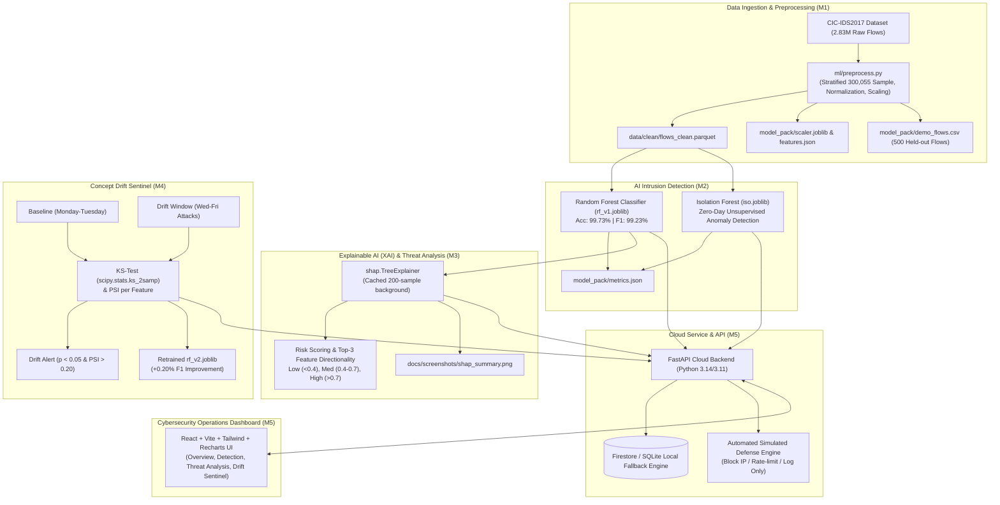

# Cloud-Based Intelligent Network Traffic Monitoring and Intrusion Detection Using Big Data Analytics

An enterprise-grade, cloud-native intrusion detection and network security analytics platform powered by machine learning, big data analytics, explainable AI (SHAP), and statistical concept drift monitoring.

---

## 1. System Architecture



---

## 2. Modules Overview & Capabilities

| Module | Name | Key Functionality | Key Artifacts |
|---|---|---|---|
| **M1** | Traffic Collection & Preprocessing | Ingests 2.83M CIC-IDS2017 rows, strips whitespace, derives Protocol, handles Inf/NaN, removes 401k duplicates, extracts 25 features, produces 300k stratified sample & 500 held-out demo flows. | `flows_clean.parquet`, `features.json`, `scaler.joblib`, `preprocess_report.json`, `demo_flows.csv` |
| **M2** | AI Intrusion Detection | Trains `RandomForestClassifier` (rf_v1) and `IsolationForest` (iso) on benign flows. Compares supervised vs unsupervised detection. | `rf_v1.joblib` (1.81 MB), `iso.joblib` (2.18 MB), `metrics.json` |
| **M3** | Explainable AI & Threat Analysis | `shap.TreeExplainer` with 200 background flows. Evaluates risk levels (Low, Med, High), extracts top 3 features with direction, formats natural language alerts. | `shap_background.csv`, `shap_summary.png`, `/alerts`, `/explain/global` |
| **M4** | Concept Drift & Adaptation | Two-sample Kolmogorov-Smirnov test and Population Stability Index (PSI). Detects feature-level drift ($p < 0.05, PSI > 0.2$). Deploys adapted model `rf_v2`. | `baseline_sample.csv`, `drift_sample.csv`, `rf_v2.joblib`, `/drift/check`, `/model/switch` |
| **M5** | Dashboard & Response Simulation | Live React telemetry dashboard, real-time packet replay simulator, automated simulated defense policy (Block IP, Rate-limit, Log), cloud resource monitoring. | React + Vite dashboard, `response_policy.json`, `Dockerfile`, `docker-compose.yml` |

---

## 3. Dataset Specifications (CIC-IDS2017)

- **Source**: Canadian Institute for Cybersecurity (CIC-IDS2017 MachineLearningCVE).
- **Total Raw Flows**: 2,830,743 across 8 CSV files.
- **Unique Clean Flows**: 2,426,545 flows (2,867 Inf/NaN rows dropped, 401,331 duplicate flows removed).
- **Working Dataset**: Stratified sample of 300,055 flows retaining all 15 attack types (DoS Hulk, DDoS, PortScan, DoS GoldenEye, FTP-Patator, SSH-Patator, DoS slowloris, DoS Slowhttptest, Bot, Web Attacks, Infiltration, Heartbleed).
- **Held-out Streaming Set**: 500 flows (350 Benign = 70.0%, 150 Attacks = 30.0%).
- **Selected Features (25)**: Protocol, Destination Port, Flow Duration, Total Fwd/Bwd Packets, Total Length of Fwd/Bwd Packets, Fwd/Bwd Packet Length Max/Min/Mean, Flow Bytes/s, Flow Packets/s, Flow IAT Mean/Max, Fwd/Bwd IAT Mean, FIN, SYN, RST, PSH, ACK, URG Flag Counts.

---

## 4. Model Evaluation & Performance Metrics

From real test set runs (60,011 held-out test flows):

| Metric | Random Forest (rf_v1) | Isolation Forest (iso) | Delta |
|---|---|---|---|
| **Accuracy** | **99.73%** | 86.89% | +12.84% |
| **Precision** | **99.21%** | 67.13% | +32.08% |
| **Recall** | **99.26%** | 48.98% | +50.28% |
| **F1-Score** | **99.23%** | 56.64% | +42.59% |
| **ROC-AUC** | **0.9999** | N/A | - |
| **Total Artifact Size** | **1.81 MB** | **2.18 MB** | Total: 3.99 MB (<100 MB target) |

### Random Forest Confusion Matrix
- **True Benign (TN)**: 49,442
- **False Alarm (FP)**: 83 (0.17% false positive rate)
- **Missed Attack (FN)**: 78 (0.74% false negative rate)
- **Detected Attack (TP)**: 10,408 (99.26% sensitivity)

### Concept Drift & Model Adaptation (M4)
- **Baseline Window**: Monday & Tuesday benign-heavy traffic.
- **Drift Window**: Wednesday, Thursday, Friday traffic with new multi-vector attacks.
- **rf_v1 on Drift Window**: Accuracy 99.80%, F1-Score 99.59%.
- **rf_v2 (Adapted) on Drift Window**: Accuracy 99.90%, F1-Score **99.80%** (+0.20% F1 improvement).

---

## 5. API Reference

| Method | Endpoint | Description |
|---|---|---|
| `POST` | `/ingest/upload` | Upload CSV of flows, validate against `features.json`, clean and scale. |
| `POST` | `/ingest/replay` | Stream batches from `demo_flows.csv` to simulate live incoming network traffic. |
| `POST` | `/predict` | Ingest single or batch flows; returns label, probability, risk level, anomaly score, and SHAP top 3. |
| `GET` | `/metrics` | Retrieve evaluation metrics for rf_v1, Isolation Forest, and drift adaptation. |
| `GET` | `/alerts` | List recorded security alerts with pagination and risk level filter (`All`, `High`, `Medium`). |
| `GET` | `/alerts/{id}` | Full SHAP waterfall breakdown for a specific alert. |
| `GET` | `/explain/global` | Global feature importance ranking calculated via SHAP TreeExplainer. |
| `POST` | `/drift/check` | Compute feature-level KS-test and PSI between baseline and current traffic window. |
| `POST` | `/model/switch` | Toggle active detection model between `rf_v1` and `rf_v2`. |
| `GET` | `/stats` | Aggregated dashboard telemetry (total flows, alert breakdown, top attackers, ports). |
| `GET` | `/cloud` | Cloud deployment metadata (provider, service, revision, memory, uptime). |
| `GET` | `/policy` | Retrieve automated simulated response policy rules. |
| `PUT` | `/policy` | Update automated simulated response policy configuration. |
| `GET` | `/actions` | Retrieve audit log of simulated defense actions. |
| `GET` | `/health` | Service health check. |

---

## 6. Local Quickstart & Development

### Prerequisites
- Python 3.11+
- Node.js 18+ and npm

### 1. Backend Setup
```bash
# Install dependencies
pip install -r backend/requirements.txt

# Run preprocessing (Module 1)
python ml/preprocess.py

# Train models (Module 2 & 4)
python ml/train.py

# Start FastAPI backend
python -m uvicorn backend.app.main:app --host 127.0.0.1 --port 8000
```

### 2. Frontend Setup
```bash
cd frontend
npm install
npm run dev
# Dashboard available at http://localhost:5173
```

### 3. Docker Compose Setup
```bash
docker-compose up --build
```

---

## 7. Cloud Deployment Guide (Serverless GCP)

### Google Cloud Platform (Recommended)
```bash
# 1. Enable required Google Cloud APIs
gcloud services enable run.googleapis.com artifactregistry.googleapis.com cloudbuild.googleapis.com firestore.googleapis.com

# 2. Create Native Firestore database
gcloud firestore databases create --location=nam5 --type=firestore-native

# 3. Create Artifact Registry repository
gcloud artifacts repositories create ids-repo --repository-format=docker --location=us-central1

# 4. Build and deploy backend to Cloud Run
gcloud builds submit --tag us-central1-docker.pkg.dev/$PROJECT_ID/ids-repo/ids-backend:latest .
gcloud run deploy ids-backend \
  --image us-central1-docker.pkg.dev/$PROJECT_ID/ids-repo/ids-backend:latest \
  --platform managed \
  --region us-central1 \
  --allow-unauthenticated \
  --min-instances 0 \
  --memory 2Gi

# 5. Build and deploy frontend to Firebase Hosting
cd frontend
npm run build
firebase init hosting
firebase deploy --only hosting
```

### Fallback Deployment (Render + Vercel)
- **Backend (Render)**: Deploy as Web Service pointing to `backend/Dockerfile`. Environment variable: `PORT=8000`, `DATABASE_MODE=sqlite`.
- **Frontend (Vercel)**: Deploy `frontend/dist` directory with environment variable `VITE_API_BASE=https://your-render-service.onrender.com`.

